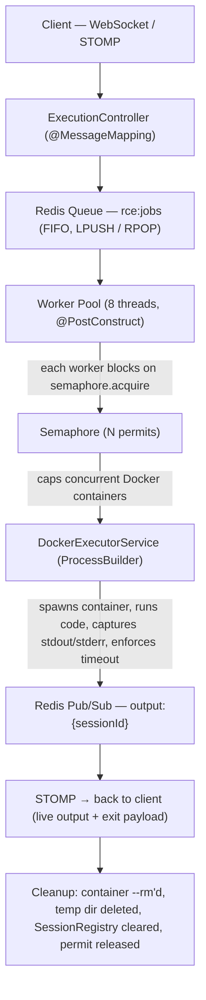

<h1>⚡ RCE Engine</h1>

<strong>A concurrent, sandboxed Remote Code Execution engine — built on Spring Boot, Docker & Redis</strong>

 

Judge0-style code execution engine — supports Python, Java, and C++, executes untrusted code inside isolated, resource-capped Docker containers, and streams output back to the client in real time.

## 📌 Overview
- Accepts code submissions (Python / Java / C++) over WebSocket (STOMP)
- Queues execution requests in Redis (FIFO) — decouples request intake from execution
- A fixed worker pool pulls jobs off the queue and hands them to a semaphore-gated Docker execution layer
- Each job runs in an isolated, auto-deleted (--rm) container with a hard memory cap and wall-clock timeout
- stdout / stderr / exit status stream back to the originating client live via Redis Pub/Sub → STOMP
- Originally built in Node.js, fully migrated to Spring Boot for better thread control and JVM-native concurrency primitives

## 🔁 Execution Flow

## 📊 Load Testing & Benchmarks

- Stress-tested locally (WSL2, 16 vCPU / 7.4GB RAM) before any cloud deployment, to validate the concurrency model under real load — not just assumed.

- Test	Jobs Pushed	Concurrent Containers	Result
Key finding: container concurrency stayed flat at the permit count regardless of whether 20 or 60 jobs were queued — confirming the queue + semaphore split works as designed under 10x burst load.

## ✅ Core Features
 - Multi-language sandboxed execution — Python, Java, C++
 - Real-time output streaming over WebSocket/STOMP (not polling)
 - Redis-backed FIFO job queue — decouples ingestion from execution
 - Semaphore-controlled concurrency — hard cap on simultaneous Docker containers regardless of queue depth
 - Live queue position updates — "queued — position N" pushed to waiting clients
 - Per-job wall-clock timeout (10s) — kills runaway/infinite-loop code automatically
 - Per-container memory limit (tested at 128MiB) — OOM isolated to the job, never the host
 - Clean error surfacing — OOM / runtime errors parsed and returned as readable messages, not raw internals
 - Automatic resource cleanup — containers, temp dirs, session state, and Redis listeners are torn down on every exit path (success, error, or interrupt)
 - CPU time tracking per execution

## 🧵 Concurrency & Scalability Design

- The core problem: N users can hit "Run" at the same time — the system must stay responsive without letting the host get overwhelmed.
- The solution — three independent layers, each bounded differently:

## Layer Mechanism, What it protects
- Intake	Redis Queue (rce:jobs)	Absorbs unlimited simultaneous submissions instantly — Redis handles this trivially
- Dispatch	8-thread Worker Pool	Pulls jobs off the queue continuously, in parallel
- Execution	Semaphore (N permits)	Hard ceiling on concurrent Docker containers — the actual expensive resource
- Queue depth can grow to thousands with zero impact on host CPU/memory
- Only the semaphore's permit count ever touches Docker — everything else just waits
- Workers that can't acquire a permit block cleanly on semaphore.acquire() — no busy-waiting, no wasted CPU
- Permit count is a single tunable constant — scales up or down based on host resources, no architectural change needed

## 🛠️ Tech Stack
- Layer	Technology
- Backend	Java 17, Spring Boot
- Real-time transport	WebSocket + STOMP (SockJS)
- Queueing	Redis (FIFO List)
- Pub/Sub streaming	Redis Pub/Sub
- Sandboxing	Docker (ProcessBuilder, --rm, per-container memory/CPU limits)
- Frontend	React (Vite)
- Deployment (dev)	WSL2 + Cloudflare Tunnel
- Deployment (target)	AWS EC2

## 🚀 Getting Started
# clone
- git clone https://github.com/somewhereMaDan/spring-RCE
- cd spring-RCE

# start Redis
- docker run -d -p 6379:6379 redis:latest

# build & run backend
- ./mvnw spring-boot:run

 run frontend (repo: https://github.com/somewhereMaDan/rce/tree/main/client)
- cd frontend
- npm install
- npm run dev

## 📂 Project Structure

- `rce-engine/`
  - `src/main/java/.../`
    - `controller/ExecutionController.java` — STOMP `@MessageMapping` entry point
    - `service/DockerExecutorService.java` — ProcessBuilder + container lifecycle
    - `service/SessionRegistry.java` — per-session process/listener tracking
    - `worker/` — queue worker pool (`@PostConstruct`)
    - `model/RunRequest.java` — `sessionId`, `lang`, `code`, `inputString`
  - `frontend/` — React (Vite), CodeSubmit UI
  - `README.md`

---

Built by Madan Mohan Kumar — https://github.com/somewhereMaDan · [LinkedIn](https://www.linkedin.com/in/madanmohankumar/)

